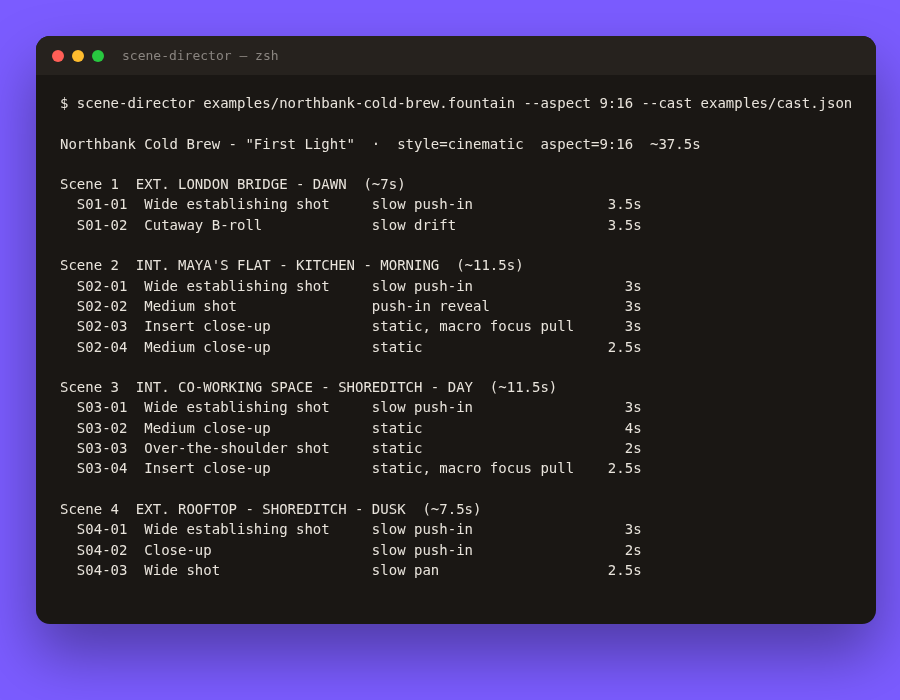

<div align="center">

# 🎬 scene-director

**Turn a screenplay into a scene-by-scene AI video shot list, with ready-to-paste prompts for image and video models.**

[](https://github.com/hbtabi/scene-director/actions/workflows/ci.yml)


[](LICENSE)

</div>

Writing a good script is half the job. Turning it into 40 consistent prompts for Flux, Midjourney, Runway, Kling or
Veo is the tedious other half. **scene-director** reads a plain-text screenplay, plans the coverage (establishing shots,
inserts, close-ups, over-the-shoulders), times every shot, and writes the prompts for you, keeping characters visually
consistent from shot to shot.

I built it for the AI video / UGC ad pipeline at [Hasenix](https://github.com/hbtabi).

## 📸 Demo

<p align="center"></p>

- **Input:** [`examples/northbank-cold-brew.fountain`](examples/northbank-cold-brew.fountain), a ~35 s spec ad for a fictional brand
- **Output:** [`examples/output/northbank-cold-brew.shots.md`](examples/output/northbank-cold-brew.shots.md) · [`.json`](examples/output/northbank-cold-brew.shots.json)

One generated shot:

```text
S03-03 · Over-the-shoulder shot · static · 2s

IMAGE  Over-the-shoulder shot of Maya, seen over Dev's shoulder, mid-sentence, natural expression.
       Setting: Interior, Co-working Space - Shoreditch, soft natural daylight. Cinematic film still,
       anamorphic, shallow depth of field, subtle film grain. Composition: foreground shoulder out of
       focus, speaker on the opposite third. ... (Maya: late-20s British-Pakistani woman, curly dark
       hair in a loose bun, oversized sage-green hoodie, small gold hoop earrings).

VIDEO  [2 s | 9:16] Static. Over-the-shoulder shot of Maya, seen over Dev's shoulder: speaking:
       "Secret weapon." ... Maya lip-syncs the line naturally.
```

## ✨ Features

- **Forgiving screenplay parser** (Fountain-flavoured): scene headings, character cues, `(V.O.)`, parentheticals, transitions, `[[notes]]`, `//` comments, title-page metadata
- **Coverage planning**: establishing shots, inserts for hands/products, close-ups for emotion, tracking for movement, over-the-shoulders for back-and-forth dialogue, B-roll for voice-over
- **Timing**: dialogue at ~2.6 words/sec, action by length, snapped to a half-second grid, with a running timecode
- **Prompts for three targets**: generic image (Flux / SDXL / DALL·E), Midjourney (with `--ar`/`--no`), and video (Runway / Kling / Veo / Sora) with camera moves and lip-sync notes
- **Style presets**: `cinematic`, `ugc`, `commercial`, `anime`; aspect ratios `16:9`, `9:16`, `1:1`, `4:5`, `2.39:1`
- **Character consistency**: a `cast.json` injects each character's look into every shot they appear in
- **Lighting from time of day**: DAWN, DUSK, NIGHT and so on map to lighting language
- **Editable templates** in `src/scene_director/templates/*.txt` (plain `string.Template`)
- **Zero dependencies**, stdlib only

## 🚀 Quick start

```bash
git clone https://github.com/hbtabi/scene-director.git
cd scene-director
pip install -e ".[dev]"

scene-director examples/northbank-cold-brew.fountain                         # summary table
scene-director examples/northbank-cold-brew.fountain -a 9:16 -s ugc -f md     # Markdown to stdout
scene-director examples/northbank-cold-brew.fountain -a 9:16 \
  -c examples/cast.json -o out/                                              # writes .shots.json + .shots.md
cat my_script.txt | scene-director - -f json | jq '.shots'                   # pipe-friendly
pytest -q
```

No install? `PYTHONPATH=src python -m scene_director examples/northbank-cold-brew.fountain`

## ✍️ Script format

```fountain
Title: My Ad
Brand: Acme

EXT. LONDON BRIDGE - DAWN

Mist hangs over the Thames as the city wakes up.

MAYA (V.O.)
Six a.m. Deadline at nine.

INT. KITCHEN - MORNING

She cracks open a can.

MAYA
(to camera, half asleep)
Okay. Let's do this.
```

## 🐍 Library usage

```python
from scene_director import parse_script, direct, to_markdown

script = parse_script(open("script.fountain").read())
shots = direct(script, style="ugc", aspect="9:16", cast={"Maya": "curly hair, green hoodie"})
for shot in shots.shots:
    print(shot.id, shot.shot_type, shot.duration, shot.video_prompt)
```

## 🗂️ Project structure

```
scene-director/
├── src/scene_director/
│   ├── parser.py        # screenplay → Script / Scene / Beat
│   ├── director.py      # coverage, timing, styles, prompt assembly
│   ├── render.py        # JSON + Markdown renderers
│   ├── cli.py           # `scene-director` command
│   └── templates/       # image.txt, midjourney.txt, video.txt
├── examples/            # sample script, cast, generated output
├── tests/               # pytest (includes a golden-file check on the sample output)
└── docs/demo.png
```

## 🛣️ Roadmap

- [ ] Optional LLM pass to rewrite prompts per model (via an OpenAI-compatible API)
- [ ] Export to CSV / Google Sheets and to an EDL for editors
- [ ] Storyboard contact sheet: batch-generate stills and lay them out as a PDF
- [ ] Full Fountain spec support (dual dialogue, sections, synopses)
- [ ] Per-shot seed and reference-image fields for consistency

## 📄 License

[MIT](LICENSE) © 2026 Mohammed Hassan bin Tayyeb · Built by [Hasenix](https://github.com/hbtabi)
